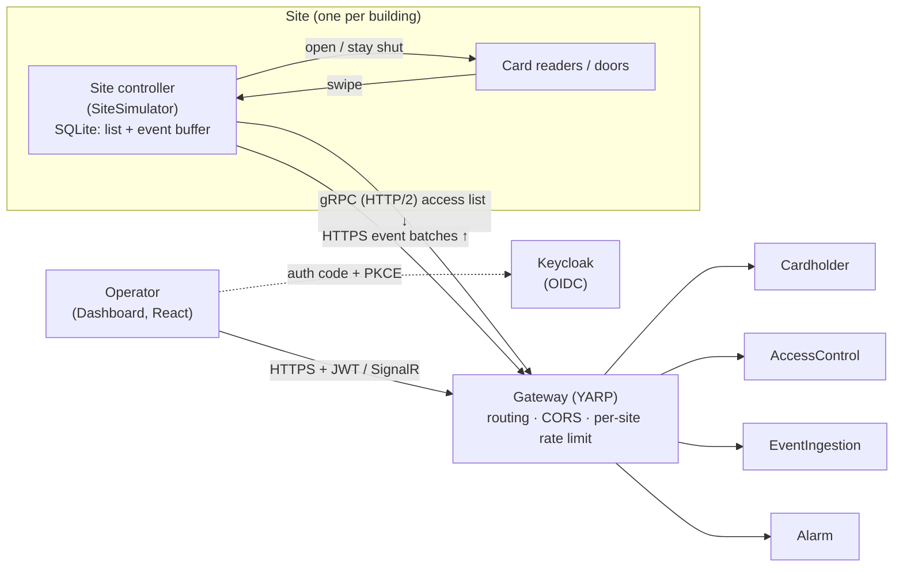
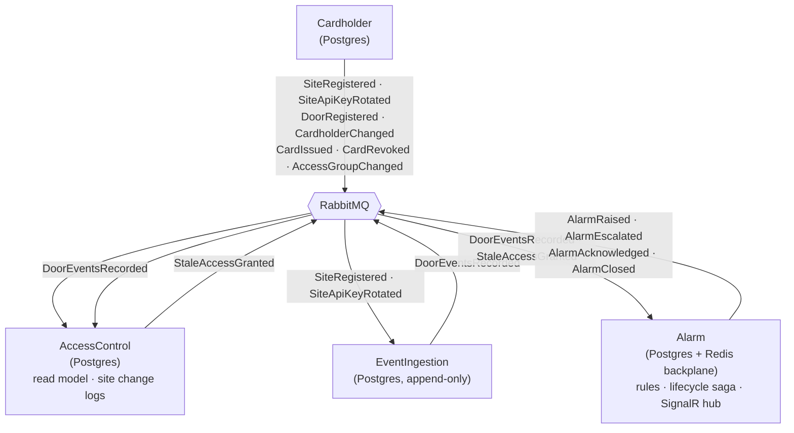
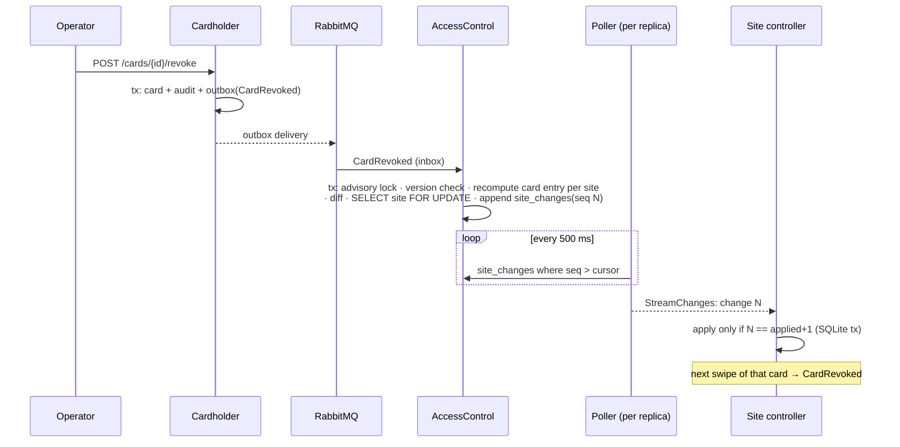
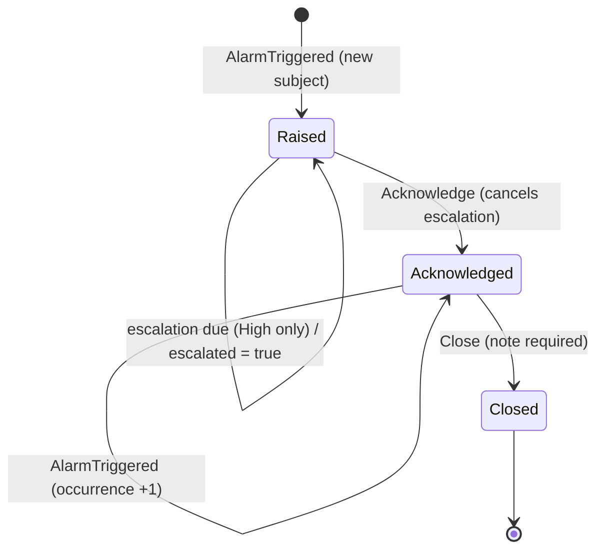

# AccessHub architecture

AccessHub manages who may open which door, distributes that to site controllers, records what happens at sites, and raises alarms.

One constraint shapes everything else: **the cloud is never in the door-open path** ([ADR 0003](adr/0003-access-decisions-at-the-edge.md)). A site decides every swipe locally from its own copy of the access list, so the cloud's job is to keep that copy correct and to find out afterwards what the site did.

## System context



## Services and messaging



| Service | Owns | Why it is separate ([ADR 0001](adr/0001-four-services-not-a-modular-monolith.md)) |
| --- | --- | --- |
| Cardholder | Sites, doors, cardholders, cards, access groups with schedules | Low, operator-driven load; may be down for minutes without affecting sites |
| AccessControl | Per-site access lists and change logs, sync status, the decision engine | Feeds every site over long-lived streams; must not depend on Cardholder being up |
| EventIngestion | Raw site events, append-only | Highest and spikiest write load; scales out on its own |
| Alarm | Alarm rules and lifecycle, the live feed | Changes most often; a deploy must not touch the path that feeds sites |

Cloud services never call each other and never read each other's database ([ADR 0002](adr/0002-database-per-service.md)). Synchronous calls exist only at the edge: site to cloud and dashboard to cloud.

## How correctness is guaranteed

| Guarantee | Mechanism | Detail |
| --- | --- | --- |
| A state change and its events commit together or not at all | Domain events are dispatched inside `SaveChangesAsync`, before commit; the integration events they map to become EF Core outbox rows in the same transaction as the change and its audit entry | [ADR 0006](adr/0006-outbox-inbox-at-least-once.md) |
| A redelivered message has one effect | Inbox deduplication by message ID, plus natural idempotency for the same fact under a new message ID: version-guarded upserts, entry diffing, `ON CONFLICT DO NOTHING`, keyed detections | [ADR 0006](adr/0006-outbox-inbox-at-least-once.md) |
| Out-of-order events converge | Cardholder events carry the aggregate `Version` and its full state; read models have no foreign keys and apply an event only if its version is newer | [ADR 0002](adr/0002-database-per-service.md) |
| A site never skips a change | Per-site sequence allocated under a row lock held until commit, so N+1 cannot commit before N; the site applies only `applied + 1` | [ADR 0004](adr/0004-access-list-sync.md) |
| A site event is stored and published once | Unique `(site_id, event_id)`; only rows actually inserted are published; the site deletes from its buffer only after acknowledgement | [ADR 0011](adr/0011-batched-door-events.md) |
| At most one open alarm per subject | Saga correlation on subject, backed by a partial unique index | [ADR 0008](adr/0008-alarm-lifecycle-as-saga.md) |
| Edge and cloud apply the same rules | One pure `AccessDecisionEngine`, referenced by both; enforced by an architecture test | [ADR 0003](adr/0003-access-decisions-at-the-edge.md) |

Consumers retry six times with exponential backoff (200 ms to 30 s), then the message moves to the error queue. No consumer swallows an exception.

## Access list distribution



- **Projection.** Each Cardholder event updates a version-guarded read model, then recomputes the entry each affected site should hold and compares it with the stored one. Only a real difference appends a change, so redeliveries, stale versions and edits invisible to a site cost nothing downstream.
- **Snapshot.** `GetSnapshot` streams the list in chunks of 500 from one `REPEATABLE READ` snapshot and ends with the sequence it reflects.
- **Stream.** `StreamChanges(from)` sends the backlog, then live changes, plus a heartbeat every 15 seconds. A `from` outside the retained log (7 days) fails with `FAILED_PRECONDITION` and the site takes a new snapshot.
- **Fan-out.** One poller per replica, every 500 ms, feeding that replica's streams in-process. Replicas share nothing but the log.
- **Revocation budget.** Outbox delivery (about 250 ms) plus poll interval (up to 500 ms) plus two commits. Measured at 201 ms end to end against a 5-second target ([ADR 0005](adr/0005-revocation-propagation.md)).

## Access decision

A pure function of `(access list, door, card number, timestamp)`. The first failing check gives the deny reason:

`UnknownCard` → `CardRevoked` → `CardExpired` → `CardholderInactive` → `NoAccessToDoor` → `OutsideSchedule` (evaluated in the site's IANA time zone).

The cardholder's active flag and group memberships are denormalised onto each card entry, so a decision is one dictionary lookup. A site that has never synced fails closed. `POST /api/v1/access/explain` runs the same engine against the cloud's copy, with no side effects.

## Site controller

| Concern | Behaviour |
| --- | --- |
| Storage | One SQLite file per site: `entries` (the list), `meta` (applied sequence, time zone), `events` (upload buffer), `rejected_events` |
| Sync | Snapshot on first start, then a change stream. A change and the new applied sequence are written in one transaction; any gap reconnects from the applied sequence |
| Decide | Always local, against the in-memory list. No network call on a swipe |
| Report | Every event is written to SQLite first. The uploader sends batches of up to 200 in `OccurredAt` order and deletes them only after the cloud acknowledges |
| Outage | Keeps deciding and buffering; reconnects with exponential backoff and full jitter so sites do not stampede on recovery |
| Poison batch | A batch the cloud rejects with 400 moves to `rejected_events` instead of blocking the buffer |

## Event ingestion

`POST /api/v1/sites/{siteId}/events` accepts 1 to 500 events. One invalid event rejects the whole batch. Events more than 5 minutes in the future are invalid; old events of any age are accepted, because a long outage produces them legitimately.

The batch is inserted with one `INSERT ... ON CONFLICT (site_id, event_id) DO NOTHING RETURNING event_id`. The rows actually inserted are published through the outbox, in the same transaction, as one `DoorEventsRecorded` per event type ([ADR 0011](adr/0011-batched-door-events.md)). The message goes to a topic exchange keyed by type, so each consumer's queue receives only the types it handles ([ADR 0010](adr/0010-type-routed-door-events-and-stateless-live-feed.md)). A replayed batch stores and publishes nothing and still returns 200 with `accepted` and `duplicate` counts.

## Alarms

| Rule | Trigger | Priority | Subject |
| --- | --- | --- | --- |
| Door forced | `DoorForced` | High | (rule, door) |
| Door held open | `DoorHeldOpen` | Medium | (rule, door) |
| Repeated denials | 3 or more `AccessDenied` for one card in any 60 s window, by `OccurredAt` | Medium | (rule, card) |
| Stale grant | `StaleAccessGranted` | High | (rule, card) |

Denials are stored (for one day), so the repeated-denials rule survives restarts and gives the same answer whatever order the events arrive in.



The lifecycle is a MassTransit saga ([ADR 0008](adr/0008-alarm-lifecycle-as-saga.md)). A high-priority alarm still `Raised` after 2 minutes escalates through a scheduled message that acknowledging cancels. An invalid transition returns 409 and changes nothing. The SignalR hub at `/hubs/alarms` pushes every site event and alarm change to dashboards; Redis is its backplane and holds no state.

## Behaviour under failure

| What fails | Effect | Recovery |
| --- | --- | --- |
| Site's link to the cloud | Site keeps deciding on its last list and buffers events. It does not see revocations; the dashboard shows it disconnected, with its lag | Reconnects with backoff, receives every missed change in order, drains the buffer |
| Cardholder | Operators cannot edit. Sites, sync, ingestion and alarms are unaffected | None needed |
| AccessControl | Sites decide on their current list; changes wait in RabbitMQ | Consumers catch up; sites resume from their applied sequence |
| One AccessControl replica | Its streams drop; a site counts as connected only with a heartbeat within three intervals, so it cannot look connected forever | Sites reconnect to another replica, which serves them from the shared log |
| EventIngestion | Sites buffer in SQLite | Sites upload on reconnect; replays are deduplicated |
| Alarm | Events wait in its queues; no alarms or live feed meanwhile | Catches up from the queue; rules use `OccurredAt`, so lateness does not change the outcome |
| RabbitMQ | Services keep committing; events accumulate in each outbox. Acknowledging and closing alarms fail, because those commands go through the broker | Outboxes drain in order. Measured: 70 s stop, 385 messages queued, drained in 31 s, none lost |
| Postgres | Readiness fails; requests and consumers fail and retry | Services recover without a restart (measured once) |

Accepted gap: a grant made by an offline site on a revoked card is detected after the fact, not prevented, and is missed if the grant is processed before the revocation reaches AccessControl ([ADR 0005](adr/0005-revocation-propagation.md)).

## Layers inside a service

```
Api ──► Application ──► Domain
 │           ▲
 └──► Infrastructure
```

- **Domain:** aggregates (Cardholder), the decision engine and list model (AccessControl), event validation (EventIngestion), alarm rules (Alarm). No infrastructure references, no public setters.
- **Application:** one handler per use case, a FluentValidation decorator, the interfaces Infrastructure implements, domain-to-integration event mapping.
- **Infrastructure:** EF Core, MassTransit consumers and the saga, gRPC fan-out, raw SQL where it matters (batch insert, sequence allocation).
- **Api:** minimal API endpoint groups, gRPC services, the SignalR hub, composition root.

`tests/ArchitectureTests` enforces the layer rules, forbids service-to-service references and limits SiteSimulator to `AccessControl.Domain`, the contracts and ServiceDefaults. A violation fails the build.

## Security

- **Operators:** Keycloak JWT (audience `accesshub-api`, flat `roles` claim). `admin` does everything, `operator` reads and acknowledges or closes alarms, `viewer` reads.
- **Sites:** `X-Site-Id` and `X-Api-Key`. Each service checks the key against a SHA-256 hash it learned from an event, in constant time ([ADR 0007](adr/0007-site-api-key-hashes-by-event.md)). The site ID comes from the authenticated key, never from the request body.
- **Audit:** every state-changing command writes an `audit_entries` row in the same transaction.
- **Rate limiting:** the gateway limits site endpoints per `X-Site-Id` with a token bucket (20 requests/s, burst 60). Malformed site IDs share one small bucket, so random headers cannot create unbounded partitions.
- **Errors:** RFC 9457 `ProblemDetails`, never a stack trace. Unhandled exceptions are logged with the trace ID.

## Observability

Every process exports OpenTelemetry traces, metrics and logs, including the simulator, so a trace starts at the site's upload and runs through ingestion, the broker and the alarm consumers. An integration event's `CorrelationId` is the W3C trace ID.

| Metric | Emitted by |
| --- | --- |
| `accesshub.access_list.propagation.duration` (histogram): event `OccurredAt` to the write on a site's stream | AccessControl |
| `accesshub.sites.connected`, `accesshub.sites.lag` (gauges) | AccessControl |
| `accesshub.events.ingested` (counter, by type and outcome) | EventIngestion |
| `accesshub.alarms.open` (gauge, by rule) | Alarm |
| `accesshub.access_decisions` (counter, by result and reason), `accesshub.access_decision.duration` (histogram) | Site controller |

Every service exposes `/health/live` and `/health/ready`; readiness checks the database and the broker.

## Deployment

- **Local:** `dotnet run --project src/AppHost --launch-profile http` starts Postgres, RabbitMQ (with the delayed exchange plugin), Redis, Keycloak (realm imported from JSON), the services, the gateway, the simulator and the dashboard. One Postgres container hosts all four databases.
- **Kubernetes:** `deploy/k8s`, a Kustomize base with dev and prod overlays. Deployments have probes and restricted security contexts; migrations run as Jobs (`--migrate`). The prod overlay runs 2 to 3 replicas per service with disruption budgets, and HPAs (3 to 10 replicas) on EventIngestion and the gateway. Postgres, RabbitMQ, Redis and Keycloak are expected as managed services.
- **Images:** built with `dotnet publish /t:PublishContainer` as `accesshub/<service>`. There are no Dockerfiles for the services.
- **gRPC port:** AccessControl and the gateway serve gRPC on a dedicated HTTP/2-only port (`GRPC_PORT`), because Kestrel does not serve cleartext HTTP/2 on an endpoint that also serves HTTP/1.1.

Measured performance: [measured-results.md](measured-results.md).
